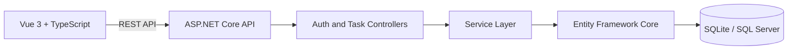

# Task Management System

[](https://github.com/Tofuhsu/task-management-system/actions/workflows/ci.yml)

A full-stack, multi-user task management application built with ASP.NET Core, Entity Framework Core, Vue 3, and TypeScript.

Users can register, sign in, and manage a private task workspace with server-side search, filtering, sorting, pagination, and dashboard summaries.

## Highlights

* JWT-based authentication with ASP.NET Core password hashing
* Authentication token stored in an `HttpOnly`, `SameSite=Strict` cookie
* Per-user authorization checks on every task read and write
* RESTful CRUD endpoints with DTO and service layers
* Server-side pagination, search, filtering, and allow-listed sorting
* Dashboard summaries generated with an aggregate database query
* Request validation with field-level Problem Details responses
* Per-IP sliding-window rate limiting on login and registration (`429` + `Retry-After`)
* Liveness (`/health/live`) and readiness (`/health/ready`) endpoints
* Centralized exception handling and structured logging
* SQLite for zero-setup local development
* SQL Server provider and migration support
* Responsive Vue 3 interface with loading, empty, validation, and API error states
* Integration tests on isolated SQLite databases and on SQL Server via Testcontainers, which runs the real EF Core migrations
* Unit tests for the task and token services, with a coverage report in CI
* k6 load test with a seeded 50,000-task dataset and recorded results ([docs/PERFORMANCE.md](docs/PERFORMANCE.md))
* Docker Compose stack (API + SQL Server) for local runs and load tests
* GitHub Actions CI for backend tests and frontend security/build checks

## Tech Stack

| Layer          | Technology                                                    |
| -------------- | ------------------------------------------------------------- |
| Backend        | ASP.NET Core 10 Web API                                       |
| Authentication | JWT Bearer, `HttpOnly` cookies, ASP.NET Core `PasswordHasher` |
| Data Access    | Entity Framework Core 10                                      |
| Databases      | SQLite for local development, SQL Server support              |
| Frontend       | Vue 3, TypeScript, Axios, Vite                                |
| Testing        | xUnit, `WebApplicationFactory`, SQLite, Testcontainers (SQL Server), coverlet |
| Load testing   | k6                                                            |
| CI             | GitHub Actions                                                |

## Architecture



The controllers handle HTTP and authentication concerns, while the service layer contains account and task behavior. DTOs define the public API contract, and Entity Framework Core manages persistence.

Every task query includes the authenticated `UserId`. If one user attempts to access another user's task—even with a valid task ID—the API returns `404`.

## Project Structure

```text
task-management-system/
├── .github/
│   └── workflows/
│       └── ci.yml
├── backend/
│   ├── TaskManager.Api/
│   │   ├── Configuration/
│   │   ├── Controllers/
│   │   ├── Data/
│   │   ├── DTOs/
│   │   ├── Infrastructure/
│   │   ├── Migrations/
│   │   ├── Models/
│   │   ├── Services/
│   │   └── Program.cs
│   ├── TaskManager.Api.Tests/
│   └── TaskManager.sln
└── frontend/
    └── task-manager-web/
        ├── src/
        │   ├── assets/
        │   ├── services/
        │   ├── types/
        │   ├── App.vue
        │   └── main.ts
        └── package.json
```

## Features

* Registration, login, logout, and a current-user session endpoint
* Case-insensitive duplicate email prevention
* JWT validation for signature, issuer, audience, lifetime, and expiration
* `Authorization: Bearer` support for non-browser clients
* Independent task status changes
* Status, priority, and due-date range filters
* Overdue and due-today calculations
* Vue 3 pages for registration, login, the task dashboard, and create/edit forms

## Run Locally

### Prerequisites

* .NET 10 SDK
* Node.js 20.19+ or 22.12+
* npm

Local development uses SQLite, so SQL Server and Docker are not required.

### 1. Clone the Repository

```bash
git clone https://github.com/Tofuhsu/task-management-system.git
cd task-management-system
```

### 2. Configure the Backend

Enter the API project:

```bash
cd backend/TaskManager.Api
```

Generate and store a local JWT signing key with .NET user secrets:

```bash
JWT_KEY=$(openssl rand -base64 48)
dotnet user-secrets set "Jwt:SigningKey" "$JWT_KEY"
unset JWT_KEY
```

The signing key is stored outside the repository and must not be committed.

### 3. Start the API

```bash
dotnet restore
dotnet build
dotnet run
```

The API defaults to:

```text
http://localhost:5100
```

Swagger is available in Development at:

```text
http://localhost:5100/swagger
```

The application creates a local SQLite database automatically.

### 4. Start the Frontend

Open a second terminal:

```bash
cd frontend/task-manager-web
cp .env.example .env.local
npm ci
npm run dev
```

Open:

```text
http://localhost:5173
```

Register an account and create your first task.

### Alternative: Docker Compose with SQL Server

Runs the production image (API + built Vue app) against SQL Server 2022:

```bash
cp .env.example .env   # then fill in MSSQL_SA_PASSWORD and JWT_SIGNING_KEY
docker compose up --build
```

Open `http://localhost:8080` (or the `API_PORT` from `.env`). The SQL Server image is
amd64-only, so on Apple Silicon Docker Desktop runs it under Rosetta emulation.

## Automated Tests

The suite has three layers:

* **Unit tests** call `TaskService` (on in-memory SQLite, so the LINQ is translated by a
  real relational provider) and `JwtTokenService` directly.
* **SQLite integration tests** start the real ASP.NET Core application in memory with a
  unique temporary SQLite database.
* **SQL Server integration tests** start SQL Server 2022 in Docker with Testcontainers,
  apply the EF Core migrations exactly as production does, check that the migration
  snapshot matches the model, and rerun the authentication and ownership tests.

No running API, local JWT secret, or development database is required.

```bash
cd backend
dotnet test TaskManager.sln                              # everything (needs Docker)
dotnet test TaskManager.sln --filter "Category!=SqlServer"   # without Docker
```

Covered behavior includes:

1. Unauthenticated users cannot access protected task endpoints.
2. Registration returns a secure `HttpOnly`, `SameSite=Strict` cookie.
3. Incorrect passwords are rejected, and duplicate emails are rejected regardless of letter case.
4. One user cannot read, update, change, or delete another user's task.
5. Credential attempts over the limit return `429` with `Retry-After`, while `/api/auth/me` stays available.
6. Liveness does not depend on the database; readiness reports the database check.
7. All migrations apply to SQL Server and no model changes are missing from them.
8. Task status resolution, search, filtering, sorting, paging, and dashboard boundaries.

## Continuous Integration

GitHub Actions runs automatically on every push and pull request to `main`.

### Backend Job

* Restores NuGet packages
* Builds the .NET solution in Release mode
* Runs unit and integration tests, including SQL Server through Testcontainers
* Publishes a code coverage summary and uploads the HTML coverage report

### Frontend Job

* Installs dependencies with `npm ci`
* Runs `npm audit`
* Performs TypeScript type checking
* Creates a production Vite build

The CI workflow is located at:

```text
.github/workflows/ci.yml
```

## API Endpoints

### Authentication

| Method | Endpoint             | Description                                              |
| ------ | -------------------- | -------------------------------------------------------- |
| `POST` | `/api/auth/register` | Register an account and create an authentication cookie  |
| `POST` | `/api/auth/login`    | Verify credentials and refresh the authentication cookie |
| `GET`  | `/api/auth/me`       | Return the currently authenticated user                  |
| `POST` | `/api/auth/logout`   | Expire the authentication cookie                         |

### Tasks

All task endpoints require authentication.

| Method   | Endpoint                 | Description                                         |
| -------- | ------------------------ | --------------------------------------------------- |
| `GET`    | `/api/tasks`             | Search, filter, sort, and paginate the user's tasks |
| `GET`    | `/api/tasks/{id}`        | Get one owned task                                  |
| `GET`    | `/api/tasks/summary`     | Get dashboard summary counts                        |
| `POST`   | `/api/tasks`             | Create a task                                       |
| `PUT`    | `/api/tasks/{id}`        | Replace editable task fields                        |
| `PATCH`  | `/api/tasks/{id}/status` | Update task status                                  |
| `DELETE` | `/api/tasks/{id}`        | Delete a task                                       |

Example query:

```http
GET /api/tasks?page=1&pageSize=10&search=backend&status=Todo&priority=High&sortBy=DueDate&sortDirection=asc
```

Supported sorting fields:

* `CreatedAt`
* `Title`
* `DueDate`
* `Priority`
* `Status`

The maximum page size is 100.

## Performance

A k6 load test (50 concurrent clients, mixed reads and writes, 50,000 seeded tasks)
showed that search on SQL Server was scanning the entire task table. Making the per-user
index cover `Title` and `Description` changed this, with everything measured on an
Apple M4 Pro laptop with SQL Server under Docker emulation (mean of 3 runs):

| | Before | After |
| --- | --- | --- |
| Throughput | 1,626 req/s | 3,216 req/s |
| p95 latency, all requests | 73.6 ms | 28.6 ms |
| p95 latency, search | 107.5 ms | 26.9 ms |

The environment, dataset, workload, query plans, and raw results are in
[docs/PERFORMANCE.md](docs/PERFORMANCE.md).

## Validation and Error Handling

Invalid requests return `400 application/problem+json` with field-level messages and a request trace ID.

Example:

```json
{
  "title": "One or more validation errors occurred.",
  "status": 400,
  "errors": {
    "PageSize": [
      "The field PageSize must be between 1 and 100."
    ]
  },
  "traceId": "00-..."
}
```

Expected authentication and account errors return:

* `401 Unauthorized`
* `409 Conflict`

Unexpected errors return a safe `500` response, while the original exception is logged by the server.

## Security Decisions

* Passwords are stored only as salted hashes.
* Plaintext passwords are never persisted or logged.
* JWT signature, issuer, audience, lifetime, and expiration are validated.
* Browser JavaScript cannot read the authentication token because it is stored in an `HttpOnly` cookie.
* Authentication cookies use `SameSite=Strict`.
* Cookies use the `Secure` flag outside Development.
* CORS uses an explicit origin allow-list.
* Task IDs are always queried together with the authenticated `UserId`.
* Login errors do not reveal whether the email or password was incorrect.
* Local JWT secrets and SQLite database files are excluded from Git.

* Login and registration are rate limited per client IP (sliding window, configurable under `RateLimiting:Auth`). The limiter is in memory, so the budget applies per instance.

This account system is suitable for a portfolio application. A public production deployment should additionally consider managed OpenID Connect or OAuth, email verification, password recovery, a distributed rate limiter, key rotation, and deployment-specific CSRF protection.

## SQL Server Support

The application uses SQLite in local Development but also includes SQL Server support.

To use SQL Server:

1. Set `DatabaseProvider` to `SqlServer`.
2. Provide `ConnectionStrings__DefaultConnection`.
3. Apply the migrations:

```bash
dotnet ef database update
```

The authentication migration is designed for a fresh database. It intentionally stops if an older SQL Server database already contains tasks without owners, because those records require an explicit ownership migration.

## Data Model

### User

* `Id`
* `Email`
* `PasswordHash`
* `CreatedAt`

### Task

* `Id`
* `UserId`
* `Title`
* `Description`
* `Status`
* `Priority`
* `DueDate`
* `IsCompleted`
* `CreatedAt`
* `UpdatedAt`

Each task belongs to exactly one user. Deleting a user also deletes that user's tasks through a cascade relationship.

## Future Improvements

* Email verification and password recovery
* Managed OpenID Connect authentication option
* OpenTelemetry traces and metrics
* Cloud deployment (configuration is in [DEPLOYMENT.md](DEPLOYMENT.md))
